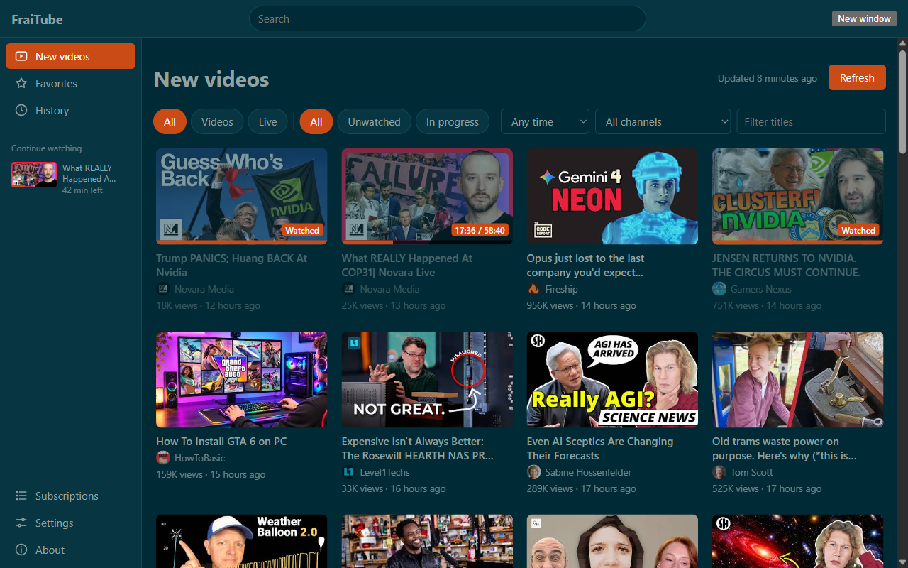
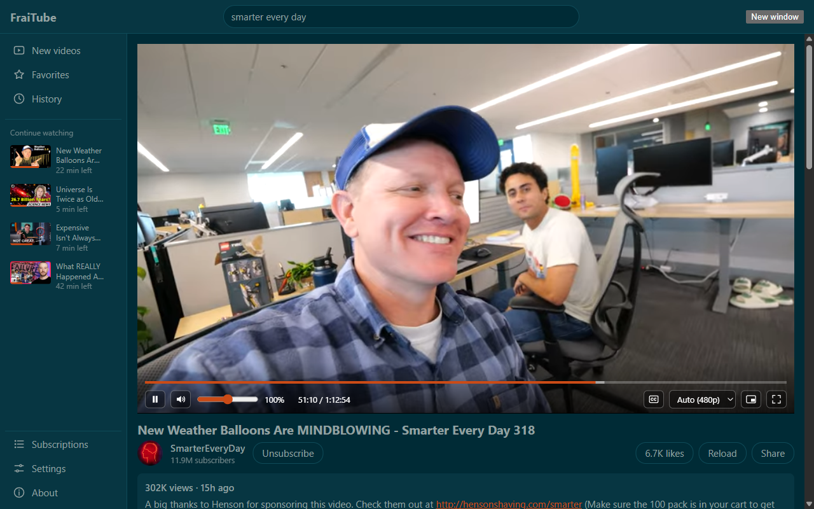
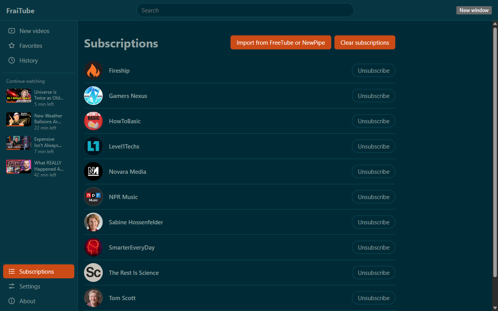
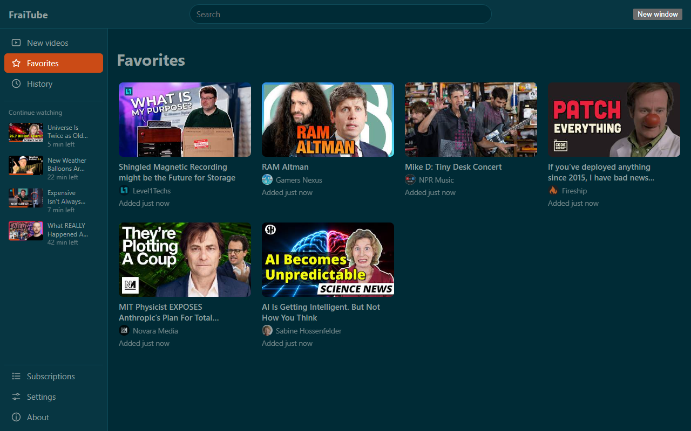
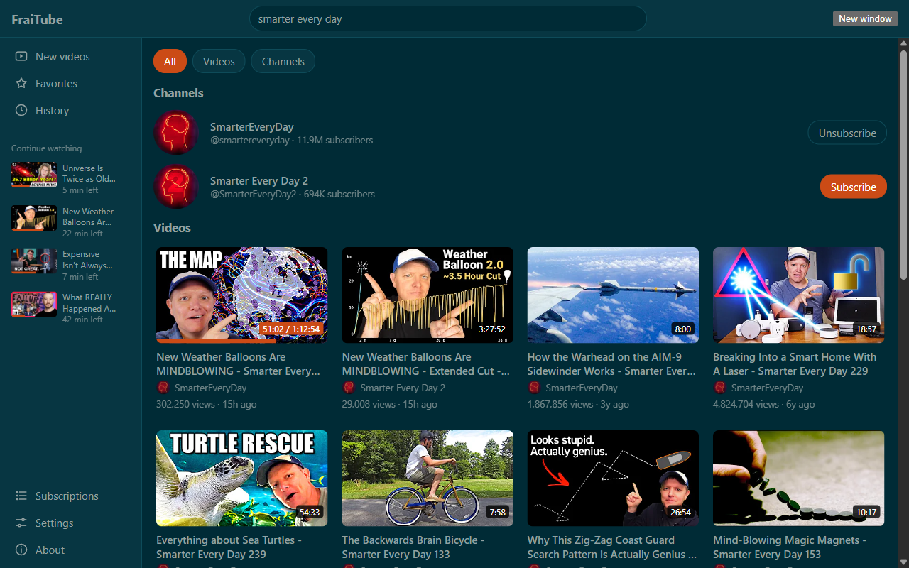
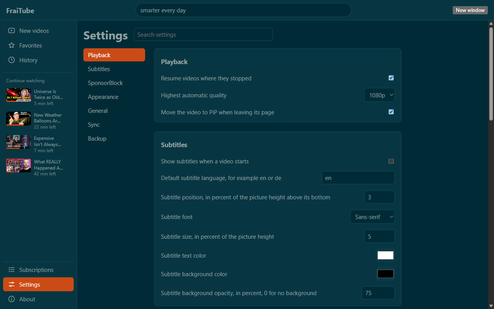

# FraiTube

A desktop app for watching YouTube videos on Windows and Linux that **needs no account**. You create subscriptions, history, favorites and watch positions locally, they stay on your own computers and, if you want, **sync across all of them**.

**[Download FraiTube for Windows and Linux](https://github.com/NixSar/FraiTube/releases/latest)**

## Why FraiTube

FraiTube builds on what FreeTube and NewPipe made possible. Many thanks to both teams for their wonderful work, which showed that YouTube can be watched freely and privately.

FraiTube adds remote syncing, so using it becomes closer to what YouTube itself offers -> the same subscriptions, history and watch positions on any Windows or Linux computer you use.

The options are pruned on purpose, but are not set in stone. FraiTube stays tight and gives you the best viewing experience instead of a wall of settings.

The developer uses it as their primary way to watch YouTube, so you can rest assured it will be maintained and made to work if it is technically possible by this code and the 3rd party code this app uses.

## Features

- **Search and watch**, with chapters, frame previews on the timeline and **SponsorBlock** segment skipping.
- **Subtitles** in the font, size, color and position you choose, and **volume up to 200%**.
- The **description, channel and comments** under every video.
- **Subscriptions without an account**, with new videos fetched every hour or at an interval of up to 24 hours that you choose, or only when you press Refresh, and **filters** for videos or live streams, unwatched or in progress, date, channel and title.
- **History** that remembers where you stopped, with progress shown on every video card and **Continue watching** for unfinished videos.
- **Favorites** for the videos you want to keep at hand.
- **Search history** under the search box, which syncs and can be turned off or cleared in Settings.
- **Picture-in-picture** in its own always-on-top window.
- **As many windows** as you like.
- **Import subscriptions and history** from FreeTube and NewPipe, merged with what you already have.
- **Sync** through any shared folder, such as one kept by Syncthing, Nextcloud or Dropbox, or through **rclone** to any cloud storage it supports.
- **Backups** to a single 7z file.

## Screenshots

| | |
| --- | --- |
|  |  |
|  |  |

## Privacy

FraiTube connects to YouTube's and Google's servers to find and play videos, to the SponsorBlock server when you turn SponsorBlock on, and to GitHub to check for a newer version when it starts and on its About page; "Check for updates when FraiTube starts" in Settings turns off the check on start. It has no account, no tracking and no usage reports. Your subscriptions, history and settings stay on your computers and in the sync folder or rclone remote you choose.

## Download

Get the latest version from the [Releases page](https://github.com/NixSar/FraiTube/releases).

- Windows: download `FraiTube-<version>-setup.exe` and run it. The installer is not signed, so Windows SmartScreen may show "Windows protected your PC"; click "More info", then "Run anyway".
- Linux: download `FraiTube-<version>-x86_64.AppImage`, make it executable with `chmod +x FraiTube-*.AppImage` or in its file properties, and run it.

## Running from the source code

You need pnpm and Node.js 22.13 or newer. Run `pnpm install` once, then double-click start.cmd on Windows or run start.sh on Linux.

## Development

FraiTube is a pnpm workspace: the app is in packages/shell, its parts are in the other folders under packages, and the tests are in tests. These commands run from the project folder:

- `pnpm dev` starts the app and reloads it as you change the code.
- `pnpm typecheck` checks the types.
- `pnpm lint` checks the code style.
- `pnpm test` runs the tests. They need Node.js 22.13 or newer in the 22 line, or version 24, or 26 and newer.
- `pnpm build` builds the app.
- `pnpm package` builds the app and packs it for the system it runs on: the Windows installer on Windows, the AppImage on Linux. The files land in the release folder.
- `pnpm test:linux` runs on Windows with WSL 2 and its Ubuntu, which needs Node.js 24 and pnpm. It copies the project into Ubuntu, runs the checks above there, makes the AppImage and starts it in a window on the Windows desktop.
- `pnpm start:linux` runs on Windows with the same Ubuntu. It copies the project into Ubuntu, builds the app there and starts it in a window on the Windows desktop.

Every push to main and every pull request is built and checked on Windows and Linux by GitHub Actions. To publish a release:

1. Set the new version in package.json and packages/shell/package.json.
2. Add the version's entry to [CHANGELOG.md](CHANGELOG.md), with a heading such as `## 0.9.0 - 2026-12-15`.
3. Push those changes to main, then push the tag `v<version>`, for example `git tag v0.9.0` and `git push origin v0.9.0`.

GitHub Actions then builds the Windows installer and the AppImage and publishes them as a release, with the CHANGELOG entry as its notes. A tag that does not match both versions stops the release.

## Credits

FraiTube uses youtubei.js, googlevideo and bgutils-js by LuanRT, Vue, vue-router, Electron and 7z-wasm. Skip segments come from SponsorBlock by Ajay Ramachandran and its contributors, under CC BY-NC-SA 4.0. See [THIRD-PARTY-NOTICES.md](THIRD-PARTY-NOTICES.md) for every license.

## License

Copyright (C) 2026 NixSar

FraiTube is free software under the GNU Affero General Public License, version 3 or later. See [LICENSE](LICENSE).

FraiTube is not affiliated with, endorsed by or sponsored by YouTube or Google. YouTube is a trademark of Google LLC.
